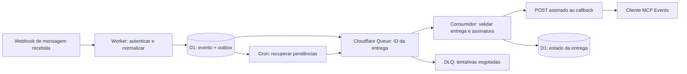

# Registro histórico: MCP Events e entrega de webhooks no WaPilot

**Data da pesquisa: 07/11/2026.** Este registro preserva a investigação e as propostas daquela data; não descreve o contrato atual nem recomenda executar sua sequência de implementação. APIs, limites e preços em dólares refletem as fontes consultadas então, sem nova verificação nesta incorporação. Não são garantias atuais nem orçamento do projeto. As garantias discutidas começavam depois da persistência no WaPilot e não corrigiam perdas anteriores no produtor de webhooks.

**Consolidação em 08/11/2026:** o [ADR 0002](../adr/0002-mcp-events-openai-e-retencao.md) registra a decisão final, implementada e publicada: retenção operacional limitada a notificações de assinaturas interessadas, sem leitura ou gravação do arquivo `webhook_events` e do cache `outbound_messages`. A proposta abaixo de reutilizar `webhook_events` foi superada. O sender escolhido usa Node em Container, conforme o ADR. Para comportamento e operação atuais, consulte [ARCHITECTURE.md](../ARCHITECTURE.md#ciclo-de-assinaturas-mcp-events), [TOOLS.md](../TOOLS.md#assinaturas-mcp-events) e [DEPLOY.md](../DEPLOY.md#filas-e-retenção-de-mcp-events). A exclusão física das tabelas legadas é uma etapa distinta, não aplicada remotamente segundo o [registro de publicação de 08/11/2026](../DEPLOY.md#publicação-controlada-de-mcp-events-em-8-de-novembro-de-2026-utc). A [issue #39](https://github.com/luccamordente/mcp-evolution-cloudflare/issues/39) preserva a especificação de implementação.

## O que existia no repositório em 07/11/2026

Inspeção do checkout na branch `luccamordente/mcp-server-notifications`, HEAD `d4582d3`. O índice TokenSave estava servindo `main`; os pontos abaixo foram conferidos nos arquivos daquele checkout, sem atualizar o índice. Os links de código desta seção apontam para a revisão histórica, não para o código atual.

| Peça | Evidência local | Consequência para a implementação |
| --- | --- | --- |
| Ingresso de webhook | [src/index.ts](https://github.com/luccamordente/mcp-evolution-cloudflare/blob/d4582d3c4ac19996a72a535612f74e4b67d3f1a8/src/index.ts), rota `POST /webhooks/evolution/:secret`, linhas 627–631 | A chegada da mensagem já pode ser detectada sem consultar periodicamente a API de mensagens |
| Validação e persistência | [src/lib/db.ts](https://github.com/luccamordente/mcp-evolution-cloudflare/blob/d4582d3c4ac19996a72a535612f74e4b67d3f1a8/src/lib/db.ts), `ingestWebhookEvent`, linhas 157–187 | Valida segredo por conexão, instância e JSON:API; remove `meta.instanceToken` e grava uma linha por recurso |
| Deduplicação | [migrations/0002_webhook_events.sql](https://github.com/luccamordente/mcp-evolution-cloudflare/blob/d4582d3c4ac19996a72a535612f74e4b67d3f1a8/migrations/0002_webhook_events.sql) | Há unicidade por `(connection_id, event_name, message_id)`; falta associar entregas aos eventos novos |
| Transporte e autenticação | [src/lib/oauth.ts](https://github.com/luccamordente/mcp-evolution-cloudflare/blob/d4582d3c4ac19996a72a535612f74e4b67d3f1a8/src/lib/oauth.ts), linhas 24–52 | O MCP está dentro do OAuth Provider, com servidor por request e resposta JSON; novos métodos devem continuar nesse caminho autenticado |
| Eventos de execução | [src/worker.ts](https://github.com/luccamordente/mcp-evolution-cloudflare/blob/d4582d3c4ac19996a72a535612f74e4b67d3f1a8/src/worker.ts) e [src/types.ts](https://github.com/luccamordente/mcp-evolution-cloudflare/blob/d4582d3c4ac19996a72a535612f74e4b67d3f1a8/src/types.ts) | Só existe handler `fetch`; não há handlers `queue`/`scheduled` nem seus bindings |
| Infra declarada | [wrangler.jsonc](https://github.com/luccamordente/mcp-evolution-cloudflare/blob/d4582d3c4ac19996a72a535612f74e4b67d3f1a8/wrangler.jsonc) | D1, KV OAuth e `global_fetch_strictly_public` já existem; não há Queues, DO ou Workflows declarados |

`ingestWebhookEvent` devolvia somente `accepted/status`, não os IDs inseridos. A proposta inicial era permitir identificar as entregas recém-criadas, sem perder o contrato de duplicatas. A busca de mensagens é atendida pelo provedor, não por `webhook_events`; adicionar notificações não exige migrar essa busca.

Naquele checkout havia divergência documental: `docs/ARCHITECTURE.md` descrevia `legacy: 'reject'`, enquanto `DEVELOPMENT.md` e o código usavam `legacy: 'stateless'`. Isso é uma observação histórica; o contrato atual usa `legacy: 'reject'`, conforme [ARCHITECTURE.md](../ARCHITECTURE.md).

O checkout canônico do upstream foi clonado/atualizado antes da leitura, no commit `ed0e7a3c093e2b15cf0c8eb003087c8d5aa59385`. Seu encoder distingue `Message`, `HistorySync` e `SendMessage`, e preserva `meta.chat`/`meta.fromMe`. O produtor HTTP dispara goroutines e tenta até cinco vezes com espera de 30 segundos; não há persistência durável nesse caminho. Isso comprova o contrato do código consultado, não a versão/configuração em produção. [Encoder consultado](https://github.com/neurau/evolution-go/blob/ed0e7a3c093e2b15cf0c8eb003087c8d5aa59385/pkg/jsonapi/encode.go), [produtor consultado](https://github.com/neurau/evolution-go/blob/ed0e7a3c093e2b15cf0c8eb003087c8d5aa59385/pkg/events/webhook/webhook_producer.go).

## Recomendação inicial da pesquisa de 07/11/2026

A recomendação inicial era usar **o Worker existente + D1 como registro durável de eventos, assinaturas e entregas + Cloudflare Queues com dead-letter queue + um Cron de recuperação**. É a combinação que reaproveita a infraestrutura existente e desacopla o recebimento da mensagem da disponibilidade do callback. A escolha é uma conclusão desta pesquisa, fundamentada nas garantias, APIs e custos abaixo, e depende da homologação de segurança do envio para callbacks.

O fluxo proposto é:

O Cron verifica apenas trabalho durável que ficou pendente. A detecção normal continua dirigida pelo webhook; não depende de consultas periódicas do cliente ou ao serviço de mensagens. `ctx.waitUntil()` pode acelerar a publicação após a resposta, mas tem limite de 30 segundos e pode ser cancelado: não deve ser a única garantia de execução. [Cloudflare Context](https://developers.cloudflare.com/workers/runtime-apis/context/#waituntil).

## Persistência e entrega

Esta seção preserva a proposta inicial. O reuso de `webhook_events` foi rejeitado na decisão final; o modelo atual seleciona notificações antes de persistir conteúdo, conforme o [ADR 0002](../adr/0002-mcp-events-openai-e-retencao.md) e [ARCHITECTURE.md](../ARCHITECTURE.md#ingresso-e-primeira-entrega-mcp-events). Os passos abaixo não são instruções de migração:

1. Validar o ingresso e identificar a conexão e o usuário pela autenticação existente. Normalizar apenas mensagens novas recebidas; histórico e mensagens enviadas têm semântica diferente.
2. **Proposta superada:** reutilizar `webhook_events` e criar apenas `subscriptions` e `deliveries`, com **`deliveries` atuando como outbox**. Gravar o novo evento elegível e suas entregas às assinaturas ativas em uma transação D1. Um ingresso duplicado não pode gerar entregas novas a assinaturas posteriores. Uma batch D1 reverte toda a sequência se uma instrução falhar. [D1 `batch`](https://developers.cloudflare.com/d1/worker-api/d1-database/#batch).
3. Publicar na Queue somente IDs internos. Evitar conteúdo de mensagens, callbacks e segredos no corpo da fila; o consumidor resolve esses dados no D1. Se publicar falhar após o commit, a outbox continua pendente.
4. O consumidor resolve uma entrega por job. Cada par `(subscription_id, event_id)` precisa de unicidade; a mesma mensagem pode legitimamente chegar a várias assinaturas. Preservar payload imutável e IDs estáveis entre tentativas e reprocessamentos.
5. Registrar estado, tentativas, próximo prazo e uma lease com expiração. Uma atualização condicional impede dois consumidores de assumir a mesma entrega simultaneamente. O Cron recupera publicações faltantes e leases vencidas, nunca entregas terminais. Limite de tentativas e deadline ficam no D1: o contador da Queue reinicia em uma nova publicação, e não pode permitir um ciclo infinito entre Cron e DLQ. Falha depois de receber `2xx`, mas antes de gravar sucesso, ainda pode causar repetição externa: não prometer exatamente uma vez.
6. Revalidar assinatura ativa, prazo, conexão e autorização antes de cada envio. Uma mensagem já enfileirada não autoriza continuar enviando depois de revogação ou unsubscribe.

O registro de assinaturas precisa preservar principal autenticado, conexão, evento, filtros canônicos, callback, segredo cifrado, verificação e expiração. A outbox resolve a falha entre banco e fila; o estado das entregas resolve repetição e operação. A Queue não substitui esses registros. Não é necessário migrar a fonte de verdade para KV, criar um servidor permanente ou manter SSE para esse fluxo.

### Modelo mínimo proposto

- `subscriptions`: identidade determinística por principal OAuth, callback, nome do evento e argumentos canônicos; dono no D1, identidade do grant/cliente OAuth, conexão, filtro opcional de conversa, segredo cifrado, status de verificação, ativação e expiração. Resolver e guardar a conexão explicitamente; uma troca futura da conexão padrão não deve redirecionar uma assinatura existente.
- `deliveries`: ID, evento de origem, assinatura, payload final imutável, estado, tentativas acumuladas, próximo vencimento, lease e resultado HTTP sanitizado. Índice para pendências por vencimento e unicidade `(event_id, subscription_id)`. Callbacks completos e segredos permanecem fora de logs, Queue e DLQ.

Uma implementação possível cria um UUID candidato para o webhook, tenta inseri-lo e insere entregas por `INSERT … SELECT` condicionado à existência desse mesmo UUID, tudo na mesma `db.batch`. Se o evento foi ignorado por duplicação, o UUID candidato não existe e não gera fan-out retroativo. Isso evita depender de uma leitura fora da transação para decidir se o ingresso era novo. Esta é uma proposta de algoritmo a testar, não SQL já implementado.

A assinatura entra em atividade depois da verificação do callback. O MVP considera eventos recebidos e persistidos depois da ativação e não oferece replay de histórico. Guardar horário original da mensagem e horário de recebimento separadamente: mensagens atrasadas não implicam relógio ou ordem de entrega confiáveis.

## Contrato MCP e evento inicial

O primeiro alvo proposto é **o perfil MCP Events do ChatGPT Work**, com entrega exclusivamente por webhook. Publicar a capability `events` em `server/discover` e implementar `events/list`, `events/subscribe` e `events/unsubscribe` no mesmo `/mcp` autenticado. O cliente fornece o callback; o servidor verifica o desafio assinado antes de ativar a assinatura e respeita refresh/expiração e unsubscribe. Isso preserva MCP `2026-07-28` e HTTP JSON stateless. A persistência das assinaturas é estado de aplicação, não sessão de transporte. [Contrato do cliente](https://developers.openai.com/plugins/build/mcp-events).

O evento de produto proposto é `message.received`, com `connectionId` explícito e `conversationId` opcional como filtros. Não criar catálogo para todo tipo de webhook nesta primeira entrega. Elegibilidade inicial: evento live `Message`, recurso `message` e direção de entrada conhecida (`fromMe === false`), com conteúdo de mensagem suportado. Excluir `HistorySync`, `SendMessage`, confirmações de leitura e eventos apenas de protocolo. Dados incompletos não devem ser classificados como mensagem recebida por suposição.

Payload enxuto: identificadores de conexão, conversa e mensagem, autor, horários e tipo de conteúdo; resumo textual só se necessário ao caso de uso. Não baixar imagem, áudio ou documento para detectar a chegada. A consulta de contexto pode ocorrer em resposta ao evento usando as ferramentas existentes. Não anexar credenciais, URLs privadas de mídia, envelope bruto ou instruções vindas da mensagem.

Limitar o número de assinaturas ativas por principal e o fan-out de um evento, além do tamanho de argumentos e payload. O perfil ChatGPT limita o corpo entregue a 256 KiB; o job da Queue deve conter só o ID, ficando muito abaixo desse teto. Definir índices de usuário/conexão/conversa para que cada webhook não varra todas as assinaturas da aplicação.

Para “alguém respondeu”, uma mensagem de entrada na conversa já permite notificar. Para provar que foi uma resposta a uma mensagem específica, é necessário extrair e validar a referência de citação do contrato do provedor; proximidade temporal não basta. Deixar esse filtro fora do primeiro evento enquanto a extração não estiver coberta por testes.

O MVP devolve `cursor: null` e não anuncia replay. Usar o perfil do cliente homologado para cabeçalhos e envelope. A proposta geral de MCP Events ainda é um draft e prevê outros modos; assinaturas de atualização de recursos (`subscriptions/listen`) são outro contrato e não garantem iniciar um turno do agente. [Draft Events](https://github.com/modelcontextprotocol/experimental-ext-triggers-events/blob/main/docs/design-sketch-proposal.md), [assinaturas do core MCP](https://modelcontextprotocol.io/specification/2026-07-28/basic/patterns/subscriptions).

Assinaturas HTTP devem cobrir os bytes exatos do corpo, o identificador e o timestamp da tentativa. Reutilizar o mesmo evento entre retries, com assinatura recente e o segredo da assinatura. Usar implementação interoperável de Standard Webhooks e vetores de teste, não um formato HMAC próprio. [Standard Webhooks](https://github.com/standard-webhooks/standard-webhooks/blob/main/spec/standard-webhooks.md).

### Compatibilidade dos pacotes fixados e revogação

Foram inspecionadas as declarações dos pacotes publicados correspondentes ao lockfile, sem instalar dependências:

- `@modelcontextprotocol/server@2.3.1` oferece `setRequestHandler(method, schemas, handler)` para métodos genéricos e `registerCapabilities`. Não foi encontrada superfície tipada de `events/list`/`events/subscribe`. Um spike deve provar que a capability passa pelo codec de discovery e que requests e respostas da extensão passam pelo handler HTTP atual. Não assumir suporte pronto nem atualizar a versão implicitamente. [Pacote consultado](https://registry.npmjs.org/@modelcontextprotocol/server/-/server-2.3.1.tgz).
- `@cloudflare/workers-oauth-provider@1.2.3`: `ctx.auth` não expõe `grantId`; a API pública `unwrapToken` devolve esse identificador e a identidade OAuth. Capturá-los durante subscribe, conferir a relação com usuário/conexão e persistir a identidade, sem guardar o bearer. `listUserGrants` permite verificar grants ativos com paginação; não foi encontrado hook público de revogação nessas declarações. [Pacote consultado](https://registry.npmjs.org/@cloudflare/workers-oauth-provider/-/workers-oauth-provider-1.2.3.tgz).

A entrega deve verificar que o usuário, conexão, assinatura e grant continuam autorizados; agrupar a consulta dos grants por usuário/batch evita uma listagem completa por evento. Integrar a revogação da UI em `authorizationApi` e cobrir também revogações feitas diretamente no Provider por revalidação da autorização, sem ler suas chaves internas do KV. Uma falha ao consultar a autorização suspende/reagenda a entrega; não concede acesso por falta de informação. Medir a janela de propagação do Provider/KV antes de prometer revogação imediata global.

Reutilizar a cifra AES-GCM já existente para o segredo de assinatura, com chave em Workers Secrets. A assinatura não concede novos escopos para enviar WhatsApp e nunca aceita a assertion Access como bearer MCP. Cancelamento, revogação e exclusão de conexão invalidam entregas pendentes. Uma requisição já em voo pode ter sido aceita pelo receiver; registrar essa fronteira em vez de prometer cancelamento retroativo.

## Opções comparadas em 07/11/2026

| Opção | O que oferece | Custo ou trabalho adicional | Adequação |
| --- | --- | --- | --- |
| **D1 + Queues + DLQ + Cron** | Buffer, tentativas, atraso e processamento independente do request | Implementar assinaturas, outbox, estado e assinatura HTTP | **Recomendada na pesquisa inicial** para um POST de evento com filtros e isolamento existentes |
| D1 + Cron, enviando diretamente | Recuperação a partir do banco, sem fila gerenciada | Construir leases, concorrência, backoff e controle de carga; precisão do agendamento limita latência | Opção menor de infraestrutura se atraso de minutos for aceitável; mais lógica de entrega própria |
| Workflows + D1 | Execução durável com passos, espera e retries | Um ciclo de vida por execução, retenção e cobrança por passos | Boa se houver processamento longo ou várias etapas duráveis por mensagem |
| Durable Objects + alarms | Estado coordenado por entidade e temporizador persistente | Novo modelo de estado/particionamento e integração com o D1 existente | Boa para ordenação estrita, limitação por destino ou futuros canais persistentes |
| QStash + Worker/D1 | Fila HTTP gerenciada com retry/DLQ | Novo fornecedor, token e endpoint de consumo; assinatura MCP continua nossa | Viável, com pouco ganho em relação a Queues nesta stack |
| Hookdeck Outpost gerenciado | Entrega multitenant, Standard Webhooks, filtros, logs e replay | Novo fornecedor com acesso a dados e segredos; gaps MCP a tratar | Alternativa operacional se observabilidade e suporte gerenciado justificarem a dependência |

### Cloudflare Queues

Queues oferece entrega **pelo menos uma vez**, portanto pode repetir mensagens. Não preserva a ordem de publicação. Uma fila admite até 128 KB por mensagem, 100 retries e 5.000 mensagens/s; o consumidor permite batch até 100 e duração de até 15 minutos. Para este caso, usar jobs pequenos, reconhecer resultados individualmente e configurar DLQ. [Garantias](https://developers.cloudflare.com/queues/reference/delivery-guarantees/), [ordem](https://developers.cloudflare.com/queues/reference/how-queues-works/), [limites](https://developers.cloudflare.com/queues/platform/limits/).

O padrão é três retries. Sem DLQ, uma mensagem que excede o limite é excluída; a DLQ precisa ter retenção e operação de reprocessamento, não ser tratada como arquivo permanente. Ajustar `max_batch_timeout` para a latência desejada: o padrão é 5 segundos e permite zero. Um `retry` deve afetar somente a entrega que falhou. [Batching, retries e delays](https://developers.cloudflare.com/queues/configuration/batching-retries/).

Para o perfil ChatGPT, considerar `2xx` como aceite, tratar falhas transitórias com backoff e tentativas limitadas e não repetir `410`/`413`. Isso deve ser decidido pelo nosso consumidor, não pelo padrão genérico da fila. Cada tentativa deve usar timestamp e assinatura novos sobre os mesmos bytes e ID estável. [MCP Events no ChatGPT](https://developers.openai.com/plugins/build/mcp-events).

### Workflows

Workflows persiste progresso entre passos e permite espera e retries configuráveis; o padrão de um passo é cinco retries com backoff exponencial. Seria útil para baixar mídia, transcrever, aguardar aprovação e só então notificar. Um único POST não justifica inicialmente esse ciclo de vida extra. [Workflows](https://developers.cloudflare.com/workflows/), [sleep e retry](https://developers.cloudflare.com/workflows/build/sleeping-and-retrying/).

Limites publicados incluem criação de 300 instâncias/s por conta no Paid, 100/s por workflow, 50.000 instâncias concorrentes em execução e até 10.000 passos por padrão. Instâncias esperando não contam para concorrência ativa. Isso dimensiona uma instância por entrega; não é uma garantia de throughput fim a fim. [Limites de Workflows](https://developers.cloudflare.com/workflows/reference/limits/).

### Durable Objects

Um objeto por assinatura ou destino pode coordenar seu backlog e um único alarme para o próximo vencimento. Alarmes executam pelo menos uma vez e têm até seis retries automáticos; ainda seria necessário guardar o calendário e reagendar recuperação após esgotá-los. Não equivalem a uma fila com DLQ pronta. [Alarmes](https://developers.cloudflare.com/durable-objects/api/alarms/).

Os objetos SQLite existem em Free e Paid. O custo inclui requests, armazenamento e **tempo ativo de parede**, inclusive I/O; é uma diferença relevante frente a Workers/Workflows cobrados por CPU. Como as assinaturas e conexões já ficam no D1, introduzir outro registro autoritativo aumenta sincronização e recuperação. A recomendação é adicionar DO apenas quando houver requisito concreto de coordenação por destino. [Preços de Durable Objects](https://developers.cloudflare.com/durable-objects/platform/pricing/).

### Alternativas externas

**QStash:** usa APIs HTTP, retries e DLQ. Sua autenticação de entrega é um JWT `Upstash-Signature`, diferente de Standard Webhooks. A integração mais segura seria QStash chamar um endpoint nosso autenticado, e esse endpoint gerar uma assinatura MCP nova a cada tentativa. Publicar uma assinatura final com timestamp congelado não resolve retries atrasados. QStash segue redirects por padrão; isso também difere da regra de callbacks MCP. [Segurança](https://upstash.com/docs/qstash/features/security), [retries e redirects](https://upstash.com/docs/qstash/features/retry).

**Hookdeck Outpost:** tem guia específico para MCP Events, multitenancy e assinatura por tentativa. O próprio guia registra gaps: tratamento de `410`/`413`, diferenças de `webhook-id` entre draft e clientes, e proteção de egress que ainda exige atenção. O serviço não elimina o código do catálogo MCP, verificação de callback, TTL e autorização. A opção gerenciada reduz operação; self-hosting adicionaria serviços e armazenamento fora do objetivo atual. [Outpost](https://hookdeck.com/docs/outpost/overview), [guia e gaps MCP](https://hookdeck.com/docs/outpost/guides/send-mcp-events-webhooks-with-outpost).

## Estimativa histórica de custo (07/11/2026)

Valores preservados da consulta de 07/11/2026, sem atualização de preços, franquias ou APIs; não constituem recomendação de contratação. A estimativa inicial também não incluía o sender em Container escolhido posteriormente.

Hipóteses: entregas pequenas, jobs menores que 64 KB, franquias disponíveis, sem retries e sem custo de inferência do agente. **Contar entregas, não só mensagens recebidas**: uma mensagem com três assinaturas pode produzir três entregas. Fan-out, jobs de ingresso separados, verificações, retries e DLQ ampliam o uso.

| Serviço | 100 mil entregas/mês | 1 milhão de entregas/mês | Premissa |
| --- | --- | --- | --- |
| Queues Paid, 1 job/entrega | US$ 0 adicional | US$ 0,80 adicional | 3 operações por job, 1 milhão incluídas/mês |
| Queues Paid, 2 jobs/entrega | US$ 0 adicional | US$ 2,00 adicionais | Cenário de dois estágios com 6 operações por entrega |
| Workflows, 3 passos/entrega | US$ 0 em passos | US$ 20 em passos | 500 mil passos incluídos; demais a US$ 0,80/100 mil |
| QStash PAYG | Cerca de US$ 1 | Cerca de US$ 10 | US$ 1/100 mil mensagens; fan-out e outras cobranças a conferir |
| Outpost Starter | Cerca de US$ 0,50 | Cerca de US$ 9,50 | 50 mil entregas incluídas e US$ 10/milhão adicional; retries não cobrados |

Esses números são contas ilustrativas das tabelas públicas, não orçamento do projeto. Na consulta de 07/11/2026, Queues não cobrava egress e existia em Free e Paid. Free inclui 10 mil operações/dia e retenção fixa de 24 horas; Paid inclui 1 milhão/mês e retenção padrão de quatro dias, configurável até 14. [Preços de Queues](https://developers.cloudflare.com/queues/platform/pricing/).

Workflows já cobra armazenamento e passos desde 10 de agosto de 2026, além de requests e CPU. Espera não consome CPU. [Preços de Workflows](https://developers.cloudflare.com/workflows/reference/pricing/).

O D1 cobra por linhas lidas/escritas e armazenamento. No Paid, inclui 25 bilhões de leituras, 50 milhões de escritas e 5 GB; excedentes custam respectivamente US$ 0,001/milhão, US$ 1/milhão e US$ 0,75/GB-mês. Índices aumentam escritas, mas evitam varreduras de pendências e assinaturas. CPU e requests do Worker são adicionais; verificar o plano e a franquia já usada na conta. [Preços D1](https://developers.cloudflare.com/d1/platform/pricing/), [preços Workers](https://developers.cloudflare.com/workers/platform/pricing/).

QStash Free permite mil mensagens/dia; PAYG inclui retenção de DLQ de sete dias. Outpost Starter tem sete dias de retenção. Usar os preços de **Outpost**, não os de Hookdeck Event Gateway, que é outro produto. [QStash](https://upstash.com/pricing/qstash), [Outpost](https://hookdeck.com/outpost/pricing).

## Egress e segurança dos callbacks

O risco não está apenas na assinatura: uma URL fornecida pelo cliente pode tentar induzir o servidor a acessar rede privada ou outro destino indevido. A regra deve valer na verificação e em **cada entrega**, incluindo retries, rotação e replay.

O repositório já usa `global_fetch_strictly_public`. A documentação descreve roteamento como Internet pública e elimina o bypass ao origin da própria zona; preservar essa flag e usar `fetch` global, sem encaminhar callbacks por bindings de rede privada. Isso é uma proteção importante, mas o texto da flag **não comprova sozinho o pinning do endereço validado** exigido pelo perfil MCP. [Compatibility flags](https://developers.cloudflare.com/workers/configuration/compatibility-flags/#global-fetch-strictly-public), [explicação da Cloudflare](https://blog.cloudflare.com/workers-environment-live-object-bindings/).

Há três incompatibilidades que impedem copiar um exemplo Node literalmente:

- Workers não implementa `redirect: 'error'`; usar `manual` e rejeitar `3xx` explicitamente. `cf.resolveOverride` é restrito à própria zona e não fixa o IP de qualquer callback externo. [Workers Request](https://developers.cloudflare.com/workers/runtime-apis/request/).
- `node:http` no Workers é um wrapper de `fetch`; `lookup` e `createConnection` não são suportados. Trocar `fetch` por `node:https` não introduz automaticamente um resolver com pinning. [Workers HTTP](https://developers.cloudflare.com/workers/runtime-apis/nodejs/http/).
- Resolver DNS antes e depois chamar `fetch` não garante que a conexão use os endereços inspecionados. O sender Node do guia Outpost usa `lookup` customizado justamente para evitar essa segunda resolução. Essa solução precisa de outra adaptação no Workers. [Guia Outpost](https://hookdeck.com/docs/outpost/guides/send-mcp-events-webhooks-with-outpost).

A pesquisa inicial sugeria limitar os callbacks a hosts de clientes explicitamente homologados, usando uma allowlist exata baseada nos endpoints reais e documentação do cliente; não inventar nem fixar domínios a partir de exemplos. Exigir HTTPS, recusar credenciais na URL e portas não autorizadas, não seguir redirecionamentos, limitar tempo/tamanho e verificar o desafio assinado antes de ativar. Uma allowlist reduz a superfície, mas não substitui a revisão de egress nem demonstra conformidade literal com pinning.

A decisão de aceitar callbacks arbitrários deve ficar condicionada a uma prova de egress: testar IPv4/IPv6 privados e especiais, DNS rebinding, redirects, nomes locais e o origin da própria zona, em ambiente real. Se o runtime não oferecer uma garantia suficiente, avaliar um sender/proxy controlado com conexão ao endereço validado e TLS para o hostname original. Não adicionar essa infraestrutura por antecipação; não declarar o problema resolvido apenas com uma consulta DNS ou a flag.

Não registrar callbacks completos, segredos, assinaturas ou conteúdo integral das mensagens em logs. Cifrar os segredos por assinatura, limitar catálogo/filtros por usuário e verificar revogação antes da entrega. Entregar resumo e identificadores quando bastarem; mídia pode permanecer sob leitura autenticada.

## Fronteiras e validação propostas antes de produção

- O produtor de ingresso também pode perder eventos. A outbox cobre falhas após o commit local; disponibilidade do produtor e entrega prévia ao commit são outra fronteira.
- A Queue e o receiver podem repetir eventos e entregá-los fora de ordem. IDs estáveis permitem ao consumidor deduplicar antes de iniciar ações que escrevem; não adicionar retries automáticos às ferramentas de envio. `2xx` confirma recebimento HTTP, não execução bem-sucedida do agente.
- Fixar o perfil de cliente e a revisão da extensão: o draft e os clientes evoluem em ritmos diferentes. Só anunciar compatibilidade após validar discovery, subscribe, verificação, refresh, expiração, unsubscribe e entrega real.
- Testar os pontos de queda entre commit/enqueue, enqueue/confirmação, POST/registro de sucesso, revogação/fila e DLQ/replay. Incluir duas contas e duas conexões para verificar isolamento.
- Acompanhar idade da outbox, backlog, erro por status sanitizado, retries e DLQ. Uma DLQ sem alerta e recuperação deixa de ser uma garantia operacional útil.

## Sequência inicial de implementação (superada pelo plano final)

1. **Provar o contrato:** discovery e handlers da extensão no SDK fixado, callback verificado e evento sintético em um cliente real. Comprovar egress seguro no runtime Workers, incluindo redirects; não usar dados pessoais nesse spike.
2. **Adicionar persistência:** migration aditiva para `subscriptions` e `deliveries`, índices e constraints; reusar o isolamento de usuário/conexão e acrescentar vínculo ao grant. Não alterar dados existentes ou a fonte de `list_messages`.
3. **Conectar ingresso e entrega:** normalização do evento, persistência/outbox atômicas, produtor da Queue, consumidor com lease e retries limitados. O ingresso responde sucesso depois do commit local; indisponibilidade do callback não bloqueia a confirmação ao produtor.
4. **Completar recuperação e operação:** Cron para pendências/leases/expiração e limpeza com retenção definida; Queue de falhas, métricas sanitizadas e procedimento de replay com rechecagem de autorização. Definir prazo máximo de entrega para não acordar o agente com backlog obsoleto.
5. **Homologar o ciclo completo:** assinar, receber mensagem real autorizada, verificar evento e execução do cliente, renovar, revogar e cancelar; confirmar também que uma mensagem sem filtro correspondente não vaza para outra assinatura.

Os pontos de mudança são `src/lib/db.ts` e a rota de ingresso, um módulo pequeno de MCP Events/delivery, a factory/contexto MCP em `src/lib/mcp.ts` e `src/lib/oauth.ts`, `src/worker.ts` para `queue`/`scheduled`, `src/types.ts`, a migration e `wrangler.jsonc`. O desenho permite os três handlers no mesmo Worker; outro deployment não é necessário para começar. Preservar o stdio de desenvolvimento com bindings remotos desativados.

Os testes devem cobrir: mensagem recebida/saída/histórico/protocolo; duplicação e falha transacional; duas contas e conexões; entrada e payload inválidos; assinatura HMAC e verificação; refresh, rotação, expiração e unsubscribe; grant revogado; queue duplicada/concorrente; queda em cada fronteira; `429`/`5xx`/timeout, `410`/`413` e sucesso; tentativas/deadline persistentes; e ausência de segredos em erros. Reutilizar `test/db.test.ts`, os testes de protocolo e o padrão de runtime workerd já usado em `test/media-worker.test.ts`. Atualizar `docs/ARCHITECTURE.md`, `docs/TOOLS.md` e `docs/DEPLOY.md` junto da implementação, não descrever a proposta como funcionalidade já publicada.

Não foram feitos benchmark, teste de cobrança, teste adversarial de rede ou homologação ponta a ponta nesta pesquisa. Nenhuma configuração de infraestrutura foi alterada.

## Revisão de arquitetura: sender HTTPS explícito

Na discussão posterior, a investigação de fontes primárias confirmou limites que tornam imprudente tratar a validação de egress como um detalhe já resolvido pelo Worker. A [documentação HTTP](https://developers.cloudflare.com/workers/runtime-apis/nodejs/http/) não suporta `lookup`/`createConnection`; [sockets](https://developers.cloudflare.com/workers/runtime-apis/tcp-sockets/) bloqueiam conexões a IPs Cloudflare; e [workerd](https://github.com/cloudflare/workerd/blob/main/src/workerd/api/sockets.c%2B%2B#L1044-L1052) declara `expectedServerHostname` em `startTls` como não suportado. `fetch` com a flag pública continua útil, mas não comprova a conexão ao IP previamente validado exigida pela OpenAI.

A opção proposta é um sender sem estado em Node completo, usando controle real da resolução/conexão e da identidade TLS. O Worker enviaria uma requisição autenticada com callback, corpo e cabeçalhos assinados; o sender faria um único POST e retornaria resultado limitado. Ele não guardaria conteúdo nem criaria um segundo sistema de retries. [HTTPS/Agent no Node](https://nodejs.org/api/https.html#class-httpsagent), [TLS](https://nodejs.org/api/tls.html#tlsconnectoptions-callback), [exigências OpenAI](https://developers.openai.com/plugins/build/mcp-events#verify-the-callback).

Naquela etapa, essa divisão ainda era uma recomendação em discussão, sem hospedagem escolhida ou serviço homologado. Posteriormente, a decisão consolidou o sender Node em Cloudflare Containers, conforme o [ADR 0002](../adr/0002-mcp-events-openai-e-retencao.md#sender-https-em-container); o [registro de publicação](../DEPLOY.md#publicação-controlada-de-mcp-events-em-8-de-novembro-de-2026-utc) distingue os resultados remotos observados dos limites da homologação. As sugestões anteriores de começar sem outro deployment ou apenas com allowlist não representam a solução final.
